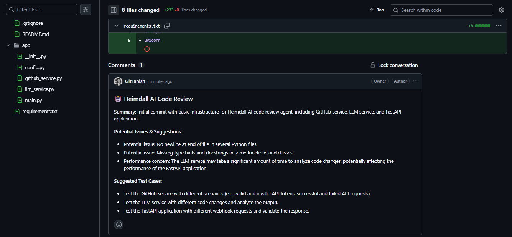

# Heimdall 🤖

**The All-Seeing AI Code Guardian**

Heimdall is an intelligent code review agent that automatically analyzes your GitHub commits and provides comprehensive feedback through AI-powered reviews. Named after the Norse god who watches over the rainbow bridge, Heimdall vigilantly guards your codebase by detecting potential issues, suggesting improvements, and ensuring code quality.

## Features

🔍 **Automated Code Analysis** – Automatically reviews every commit pushed to your repository  
🧠 **AI-Powered Reviews** – Leverages Groq's Llama 3 70B model for intelligent code analysis  
📝 **Comprehensive Feedback** – Provides summaries, issue detection, documentation drafts, and test suggestions  
⚡ **Real-time Integration** – Responds immediately to GitHub webhook events  
🔧 **Easy Setup** – Simple configuration with environment variables

## Tech Stack


- **Backend**: FastAPI (Python web framework)
- **AI/LLM**: Groq API with Llama 3 70B model
- **GitHub Integration**: GitHub REST API v3
- **HTTP Client**: Requests library
- **Environment Management**: python-dotenv

## Demo

Here's Heimdall in action — automatically reviewing a commit and posting structured AI feedback directly on GitHub:

  

## How It Works

1. **Webhook Trigger**: GitHub sends a webhook when code is pushed to your repository
2. **Signature Verification**: Heimdall validates the `X-Hub-Signature-256` HMAC and rejects forged payloads
3. **Diff Retrieval**: Heimdall fetches the diff of **each commit** in the push using GitHub's API
4. **AI Analysis**: The code changes are analyzed by Groq's Llama 3 70B model
5. **Review Generation**: AI generates a structured review with actionable insights
6. **Comment Posting**: The review is posted as a comment on that specific commit

A failure on one commit does not stop the others — the response reports a
per-commit breakdown so a partial review is visible.

## Review Components

Each Heimdall review includes:

- **Summary**: Executive overview of the changes
- **Potential Issues**: Bugs, style violations, performance concerns, security issues
- **Documentation**: Auto-generated docs for new functions and classes
- **Test Suggestions**: Recommended unit tests to validate the changes

## Quick Start

### Prerequisites

- Python 3.10+ (the code uses PEP 604 `X | None` annotations)
- GitHub repository with webhook access
- Groq API account

### Installation

1. **Clone the repository**
   ```bash
   git clone https://github.com/GitTanish/Heimdall.git
   cd Heimdall
   ```

2. **Install dependencies**
   ```bash
   pip install fastapi uvicorn requests groq python-dotenv
   ```

3. **Configure environment variables**
   Create a `.env` file in the root directory:
   ```env
   GROQ_API_KEY=your_groq_api_key_here
   GITHUB_TOKEN=your_github_personal_access_token
   GITHUB_WEBHOOK_SECRET=any_random_string_you_choose
   ```
   Generate a good secret with:
   ```bash
   python -c "import secrets; print(secrets.token_hex(32))"
   ```
   `GITHUB_WEBHOOK_SECRET` must match the **Secret** you set on the GitHub
   webhook (step 5 under *GitHub Webhook Setup* below). Heimdall verifies every
   delivery against it and **rejects the request with 401 if the signature does
   not match**. Without it the webhook endpoint returns 503 and posts nothing.

4. **Run the application**
   - Local development:
     ```bash
     uvicorn app.main:app --reload
     ```
   - Production deployment:
     ```bash
     uvicorn app.main:app --host 0.0.0.0 --port 8000
     ```

### GitHub Webhook Setup

1. Go to your GitHub repository settings
2. Navigate to **Webhooks** → **Add webhook**
3. Set the Payload URL to your Heimdall instance:
   - Local development (with [ngrok](https://ngrok.com/)):
     ```bash
     ngrok http 8000
     ```
     Use the generated `https://xxxx.ngrok-free.app/webhook/github` as the Payload URL
   - Production: `https://yourdomain.com/webhook/github`
4. Select **Content type**: `application/json`
5. Set **Secret** to the same value as `GITHUB_WEBHOOK_SECRET` in your `.env`
6. Choose **Just the push event**
7. Save the webhook

## API Endpoints

### `GET /`
Health check endpoint to verify Heimdall is running.

**Response:**
```json
{
  "status": "Heimdall AI Agent is running!"
}
```

### `POST /webhook/github`
Webhook endpoint for GitHub push events. Validates the `X-Hub-Signature-256`
signature, then reviews **every commit in the push** and posts a comment on each.

**Expected Payload:** GitHub push event webhook payload, signed

**Response:**
```json
{
  "status": "success",
  "message": "Reviewed 2 of 2 commit(s) in octocat/hello-world",
  "summary": { "reviewed": 2, "skipped": 0, "failed": 0 },
  "results": [
    { "commit": "abc123...", "status": "reviewed" },
    { "commit": "def456...", "status": "reviewed" }
  ]
}
```

**Status codes:**

| Code | Meaning |
|------|---------|
| `200` | Processed (or deliberately skipped: non-push event, branch deletion, no commits) |
| `400` | Body is not valid JSON, or `repository` owner/name is missing |
| `401` | `X-Hub-Signature-256` missing or invalid |
| `503` | `GITHUB_WEBHOOK_SECRET` not configured on the server |

A push is reported as `partial` when some commits failed; the remaining commits
are still reviewed. Reviews are capped at 20 commits per push, and diffs are
truncated to 60,000 characters to stay inside the model context window.

## Configuration

### Environment Variables

| Variable | Description | Required |
|----------|-------------|----------|
| `GROQ_API_KEY` | Your Groq API key for LLM access | Yes |
| `GITHUB_TOKEN` | GitHub Personal Access Token with repo permissions | Yes |
| `GITHUB_WEBHOOK_SECRET` | Shared secret used to verify GitHub webhook signatures | Yes |

Heimdall refuses to start if `GROQ_API_KEY` or `GITHUB_TOKEN` is missing, and
refuses webhook deliveries (503) if `GITHUB_WEBHOOK_SECRET` is missing.

### GitHub Token Permissions

For **classic Personal Access Tokens**:
- `repo` (Full control of private repositories)

For **fine-grained tokens**:
- **Contents** → Read and write

## Architecture

```
┌─────────────────┐
│   GitHub Repo   │
│   (Webhook)     │
└───────┬─────────┘
        │
        ▼
┌─────────────────────────┐
│     Heimdall (API)      │ ◄──────────┐
│  ─ FastAPI Webhook      │           │ (Analysis Result)
│  ─ GitHubService        │           │
│  ─ LLMService           │           │
└───────┬─────────┬───────┘           │
        │         │                   │
┌───────▼──────┐  │  ┌─────────────┐  │
│  GitHub API  │  └─▶│  Groq LLM   │──┘
│ (fetch diff) │     │  Analysis   │
└──────────────┘     └─────────────┘
        │
        │ (Heimdall then posts the comment)
        │
        ▼
┌──────────────┐
│  GitHub API  │
│(commit cmts) │
└──────────────┘
```

## Deployment

### Using Docker (Recommended)

```dockerfile
FROM python:3.9-slim

WORKDIR /app
COPY requirements.txt .
RUN pip install -r requirements.txt

COPY . .
EXPOSE 8000

CMD ["uvicorn", "app.main:app", "--host", "0.0.0.0", "--port", "8000"]
```

### Using Cloud Platforms

Heimdall can be deployed on:
- **Railway**: Direct GitHub integration
- **DigitalOcean App Platform**: Single-click deployment
- **AWS Lambda**: With FastAPI adapter
- **Google Cloud Run**: Container deployment

## Example Review Output

```markdown
### 🤖 Heimdall AI Code Review

**Summary:** Added user authentication middleware with JWT token validation.

**Potential Issues & Suggestions:**
- Consider adding rate limiting to prevent brute force attacks
- The JWT secret should be loaded from environment variables
- Missing error handling for expired tokens

**Documentation Draft:**
```markdown
## authenticate_user(token: str) -> User | None
Validates JWT token and returns authenticated user object.
```

**Suggested Test Cases:**
- Test valid JWT token authentication
- Test expired token rejection
- Test malformed token handling
- Test missing token scenario
```

## Contributing

Contributions are welcome! Feel free to submit issues, feature requests, or pull requests.

## Troubleshooting

### Common Issues

**Webhook not triggering:**
- Verify the webhook URL is accessible from GitHub
- Check that the endpoint returns 200 status
- Ensure the webhook is configured for push events

**401 / "Webhook signature is invalid":**
- `GITHUB_WEBHOOK_SECRET` in `.env` must match the **Secret** field on the GitHub webhook
- Re-save the webhook after changing the secret; GitHub caches the setting
- Restart Heimdall after editing `.env`

**503 / "Webhook secret is not configured":**
- `GITHUB_WEBHOOK_SECRET` is not set. Heimdall fails closed on purpose — add it before restarting

**No review on a large push:**
- Only the first 20 commits in a push are reviewed
- Branch deletions and pushes with no commits are skipped by design

**API errors:**
- Verify your Groq API key is valid and has credits
- Check your GitHub token has the required permissions
- Review the application logs for detailed error messages

**Comments not posting:**
- Ensure the GitHub token has write permissions
- Verify the repository owner/name in the webhook payload
- Check for network connectivity issues

## License

This project is licensed under the MIT License - see the [LICENSE](LICENSE) file for details.

## Acknowledgments

- Named after Heimdall, the all-seeing guardian of Norse mythology
- Powered by [Groq](https://groq.com/) for lightning-fast AI inference
- Built with [FastAPI](https://fastapi.tiangolo.com/) for robust webhook handling

---

**"I can see all the way to the end of the rainbow bridge... and your code bugs too."** 🌈👁️